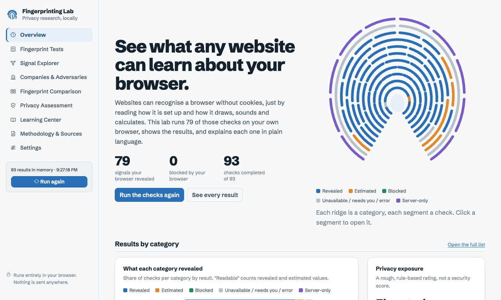
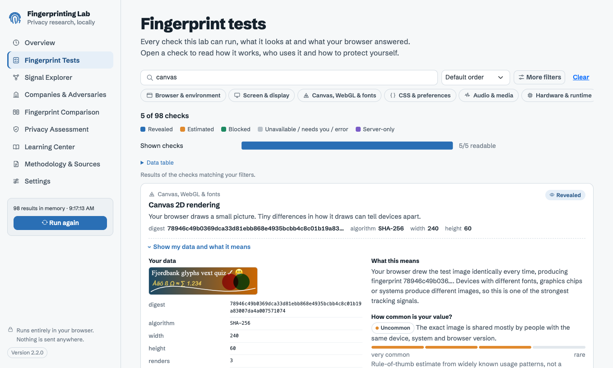
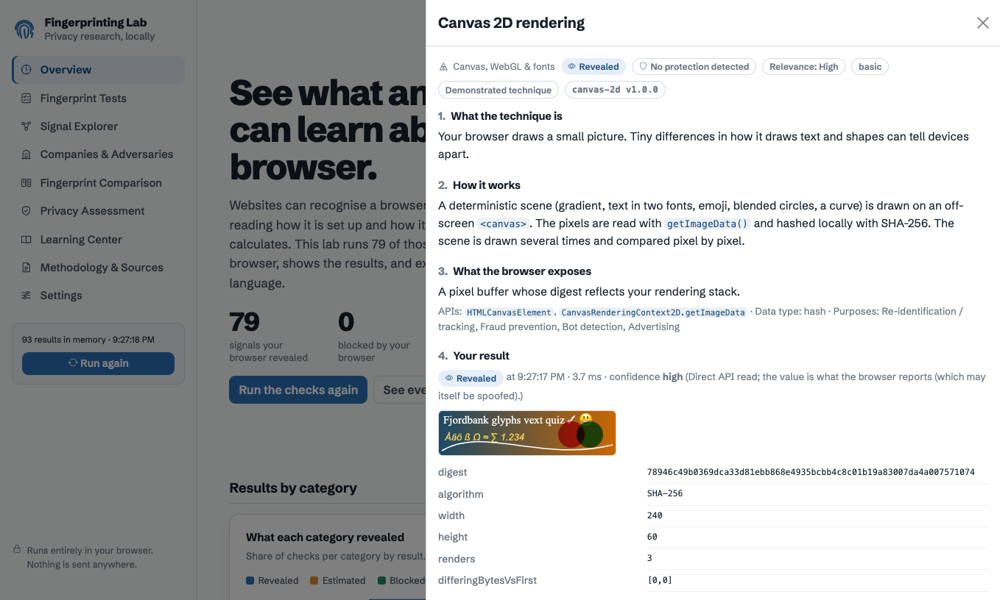
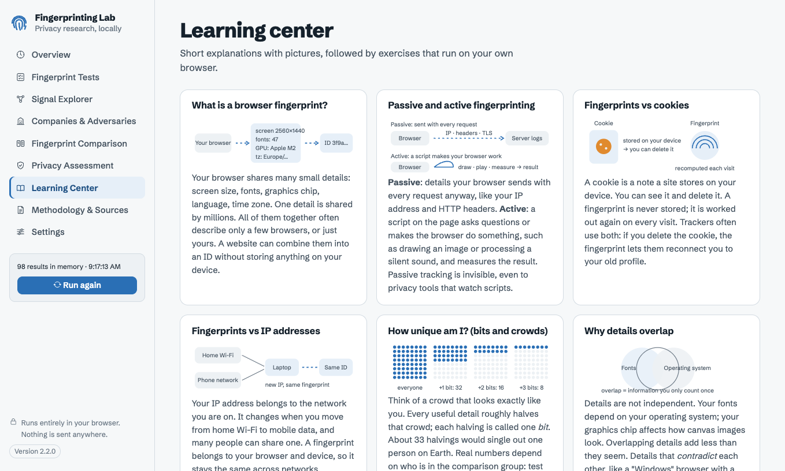
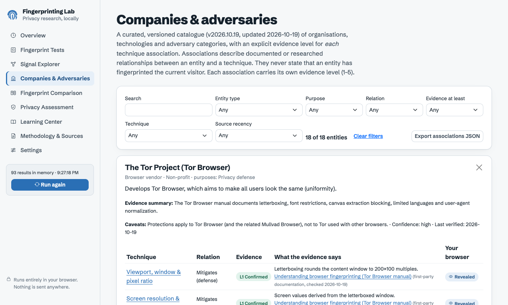
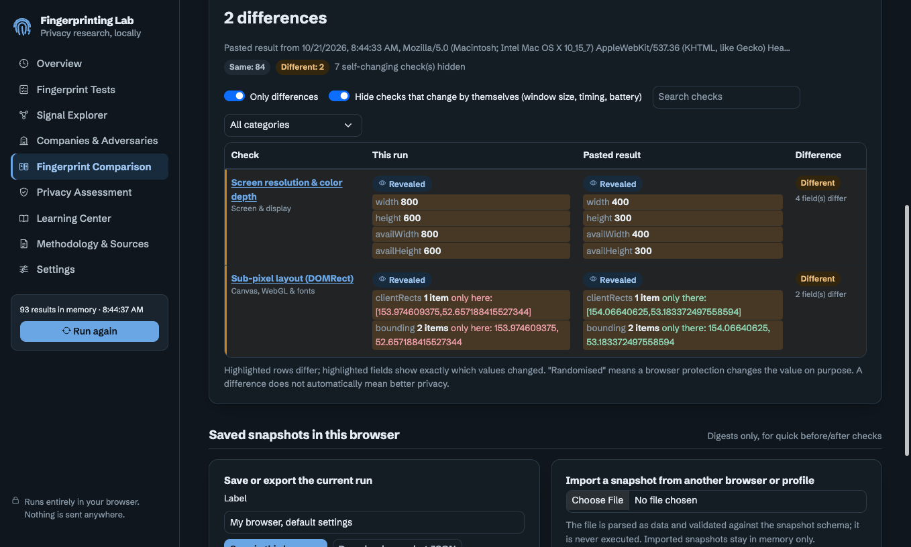
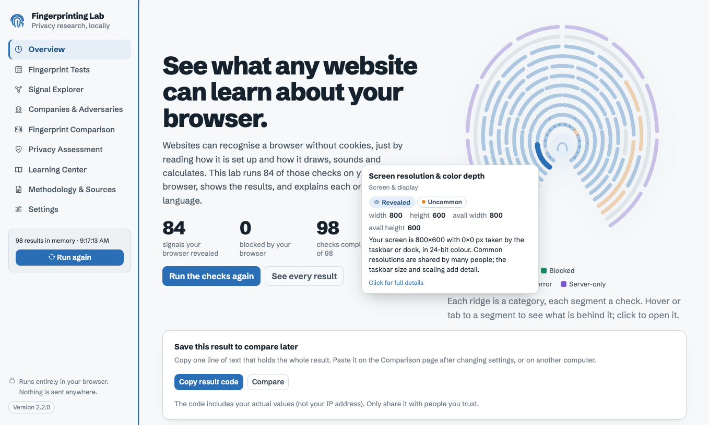
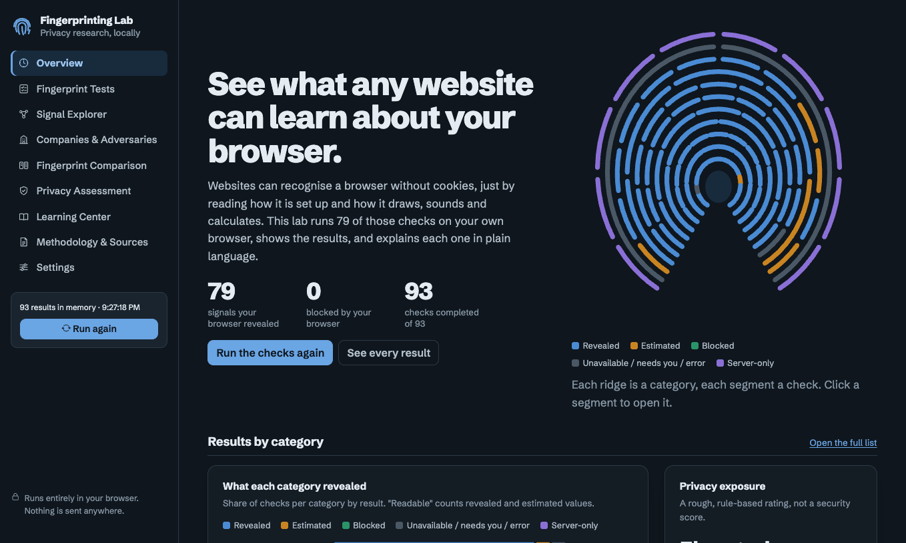

# Fingerprinting Lab

**See what any website can learn about your browser, without cookies.**

**Live demo: https://jozeta.github.io/Fingerprinter/** · Current version: **2.2.1** ([changelog](CHANGELOG.md))

An educational, defensive privacy lab that runs real browser-fingerprinting techniques against your own browser, shows exactly what each one revealed, and explains it in plain language. Every technique is linked to documented real-world use, with an explicit evidence level. Everything runs locally: nothing is sent anywhere.



## What it does

- **98 techniques**, from basic to advanced. They cover the full 65-item test list in [docs/TEST-COVERAGE.md](docs/TEST-COVERAGE.md):
  - **Basic:** User-Agent and Client Hints, screen and display, languages and time zone.
  - **Rendering:** canvas, WebGL and WebGPU, emoji and text metrics, fonts, SVG.
  - **Audio and media:** offline audio, hardware video decoding and encoding.
  - **Engine behaviour:** CSS and media queries, WebAssembly features, timers, error formats, prototype surfaces.
  - **Storage, permissions and APIs.**
  - **Cross-signal consistency and automation detection.**
  - **Server-side techniques** (TLS JA3/JA4, HTTP/2, IP, script-less CSS), explained but not measured.
- **Clear results:** each check is marked in plain words: *Revealed*, *Estimated*, *Hidden by browser*, *Not in this browser*, *Start it yourself* or *Only servers see this*. Expand any result to see your actual data, a plain-language explanation of what *your* value means, **how common your value is** (a labelled estimate) and **how identifying the check is** (published entropy where verified), why it matters, and how to hide or blur it.
- **Companies & adversaries:** a versioned catalogue (FingerprintJS, Google, Meta, Cloudflare, DataDome, Akamai, EFF, Tor Project, Brave, Mozilla, Apple, researchers and adversary categories). Every link to a technique carries an evidence level from *L1 Confirmed* to *L5 Unverified*, plus sources.
- **Signal explorer:** choose which signals form your local fingerprint, watch the SHA-256 digest change, and see how signals connect.
- **Result codes & side-by-side comparison:** after a run, copy one line of text (`FPLAB1.…`) that holds the entire result. Change a setting or move to another computer, run again, paste the old code, and get a detailed side-by-side table with every difference highlighted and an "only differences" filter. Codes are compressed and base64url-encoded. A *full* code includes the actual values; a *compact* code only fingerprints of them. Local IP addresses are never included.
- **Privacy assessment:** a rule-based rating with documented rules and a confidence level. It is explicitly not a security score.
- **Learning center:** illustrated lessons and hands-on exercises, such as "Does clearing cookies change your fingerprint?"
- **Hover to explore:** hover over or tab to any part of the fingerprint figure or the category chart to see the checks and values behind it.
- **Reports:** JSON exports (raw data excluded by default) and a printable report (print to PDF).

## Screenshots

| | |
|---|---|
|  |  |
| **Fingerprint tests**: search, filter and see what each check returned | **Technique detail**: plain-language explanation, your actual result, evidence and how to protect yourself |
|  |  |
| **Learning center**: illustrated lessons and hands-on exercises | **Companies & adversaries**: documented use, each link with an evidence level and sources |


*Comparing two setups with a result code: rows and individual values that differ are highlighted.*


*Hover over the fingerprint figure or the category chart to see what is behind each part.*


*Dark mode, with its own colour steps tuned for the dark background.*

Screenshots were taken in a headless test browser; your own results will differ.

## Privacy by design

- No backend, analytics, CDN or third-party requests. All assets, including the font, are self-hosted. A Content Security Policy enforces `connect-src 'self'`.
- Tests run only after you click **Run**. Nothing is stored unless you save a snapshot or enable "remember settings".
- No permission prompts: no camera, microphone, location, clipboard or notifications. No IP lookup and no STUN servers.
- No uniqueness percentage is shown, because that would require a representative comparison dataset. See [docs/METHODOLOGY.md](docs/METHODOLOGY.md).

Full details are in [docs/PRIVACY.md](docs/PRIVACY.md).

## Run locally

ES modules do not work from `file://`, so serve the folder over HTTP:

```sh
python3 scripts/serve.py        # http://localhost:8765/ (like http.server, but with caching disabled)
```

`localhost` counts as a secure context, so Web Crypto, the Storage API and Cache API work.

> **Tip:** if the page shows "The lab did not start", an ad/tracker blocker may be blocking a file, or your browser may have cached old files. The error screen explains which.

## Deploy

It is a static site with no build step: copy the folder to any static host. This repo is published with **GitHub Pages** from the `main` branch root (`.nojekyll` keeps files served as-is). Serve over HTTPS, since secure-context APIs need it.

## Tests

Requires Node.js 22 or newer. No dependencies.

```sh
npm test                 # unit tests: registry, schema, engine, hashing, fingerprint, compare, filters,
                         # export/import, assessment, recommendations, 65-item coverage, static privacy scan
python3 scripts/serve.py &
BROWSER="/Applications/Microsoft Edge.app/Contents/MacOS/Microsoft Edge" npm run test:browser
```

`test:browser` drives a headless Chromium-based browser over the DevTools protocol. It runs two suites:
- **Integration suite** (`tests/browser/index.html`): real APIs, schema validity, no fabricated values, storage and DOM cleanup, and no cross-origin requests.
- **UI walkthrough:** visits every view and checks that tests don't run before consent and that there are no console errors. It also saves screenshots.

## Project structure

| Path | Contents |
|---|---|
| `index.html`, `css/app.css` | App shell, CSP, "Fjord & frost" theme (light/dark/system) |
| `js/core/` | Registry, result schema, execution engine, hashing, opt-in storage |
| `js/tests/` | Technique definitions, one module per category |
| `js/analysis/` | Fingerprint profile, comparison, assessment, recommendations, filters, reports |
| `js/ui/` | Views, charts, custom icons, lesson illustrations |
| `data/` | Versioned entity catalogue and source registry |
| `docs/` | Architecture, methodology, privacy, server adapter, technique reference, test coverage |

Adding a technique means adding one `define({...})` object to a module in `js/tests/`. The registry validates it, and views, filters, docs and exports pick it up automatically. Run `npm run docs` to regenerate [docs/TECHNIQUES.md](docs/TECHNIQUES.md).

## Documentation

- [Architecture & data model](docs/ARCHITECTURE.md)
- [Methodology](docs/METHODOLOGY.md): aggregation, assessment rules, evidence levels, limitations
- [Privacy statement](docs/PRIVACY.md)
- [Technique reference](docs/TECHNIQUES.md) (generated)
- [Test coverage](docs/TEST-COVERAGE.md) (generated)
- [Optional server adapter](docs/SERVER-ADAPTER.md) (disabled by default)

## License

[MIT](LICENSE). Bundled third-party components keep their own licenses: Bootstrap 5.3.3 and Bootstrap Icons 1.11.3 (MIT), and Schibsted Grotesk (SIL Open Font License 1.1, [vendor/fonts/OFL.txt](vendor/fonts/OFL.txt)).

This is an educational and defensive research tool. It measures only the browser it runs in and never claims that any organisation has fingerprinted you.
